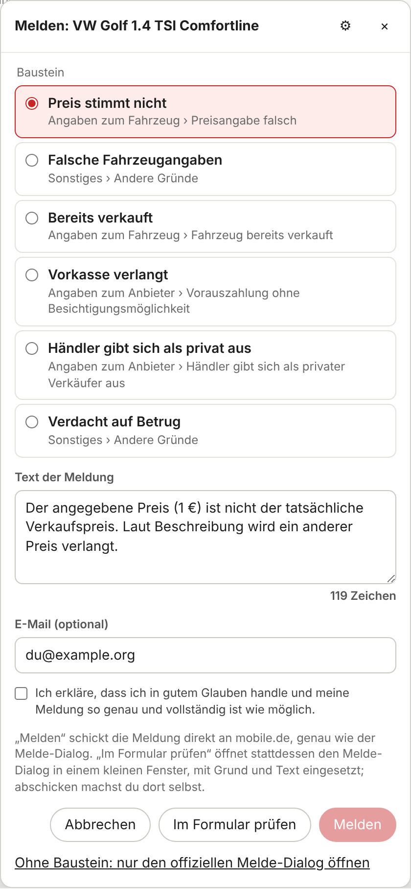
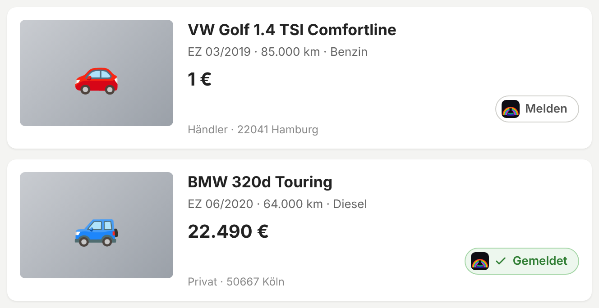
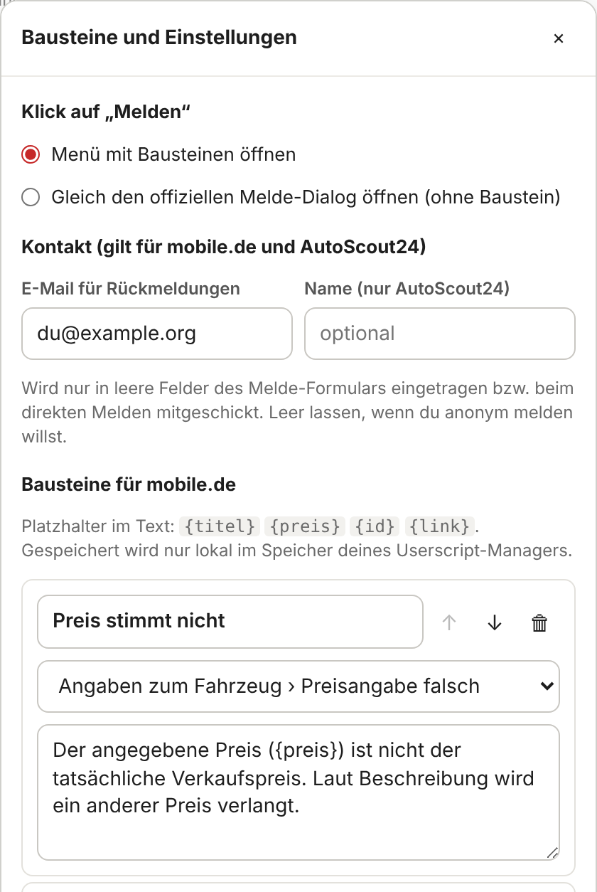

# 🚩 Auto Super-Meldescript: mobile.de & AutoScout24

**Unsaubere Fahrzeug-Inserate direkt aus den Suchergebnissen melden, mit eigenen Bausteinen und ohne die Liste zu verlassen.**

*Chrome · Firefox · Edge · Kein Server · Kein Tracking · Meldet wie die offiziellen Formulare*

---

> [!IMPORTANT]
> **Frühe Version (0.3.0).** **AutoScout24** ist an der Live-Seite getestet (Stand 10/2026). Bei **mobile.de** stammen Melde-Dialog, Gründe und die Anfrage fürs direkte Melden aus einer echten Inseratsseite und ihrem Script, getestet ist das bisher nur an nachgebauten Seiten: mobile.de lässt die Testumgebung nicht auf die Seite. Noch gar nicht geprüft ist der Aufbau der Suchergebnisse von mobile.de. Details unter [🧪 Getestet](#-getestet).

Wer auf mobile.de oder AutoScout24 ein Auto sucht, kennt das: **„1 €“**, Preise, die laut Beschreibung gar nicht gelten, Kilometerstände, die nicht zu den Fotos passen, längst verkaufte Fahrzeuge und Inserate, die nach Vorkasse-Betrug aussehen.

Melden kann man sie, aber dafür muss man jedes Inserat öffnen, den Melde-Link suchen und danach zurück zur Liste. Dabei geht oft die Scroll-Position verloren.

**Dieses Userscript setzt einen „Melden“-Button an jedes Inserat in der Ergebnisliste.** Ein Klick öffnet ein kleines Menü direkt am Button. Dort wählst du einen **Baustein** (Grund und fertiger Text), passt den Text bei Bedarf an, bestätigst und meldest. Es öffnet sich kein Fenster, und deine Suchergebnisse bleiben, wie sie sind. Wer lieber selbst ins offizielle Formular schaut, öffnet es mit einem Klick in einem kleinen Fenster, Grund und Text sind dort schon eingesetzt.

  
   Das Melden-Menü in der Übersicht (Darstellung an einer nachgebauten Seite).

  
   Der Button an den Inseraten: oben „Melden“, unten nach erfolgreicher Meldung „Gemeldet“.

---

## 🔀 Zwei Wege zum Melden

Beide Wege starten am selben Button und nutzen dieselben Bausteine. Du entscheidest bei jeder Meldung neu.

| | **Direkt melden** (Button „Melden“ im Menü) | **Im Formular prüfen** |
|---|---|---|
| Wo | im Menü in der Übersicht, ohne Fenster | im offiziellen Melde-Formular, in einem kleinen Popup |
| Grund und Text | aus dem Baustein | aus dem Baustein, im Formular schon eingesetzt |
| Absenden | das Script, nach deiner Bestätigung „in gutem Glauben“ | du selbst im Formular |
| Anfrage an die Seite | dieselbe, die das offizielle Formular schickt | keine eigene, alles läuft über das Formular |
| Gründe | alle Gründe der Seite | alle Gründe der Seite |

Ohne Baustein öffnet **„Ohne Baustein: nur … öffnen“** das leere offizielle Formular. In den Einstellungen kannst du festlegen, dass ein Klick auf „Melden“ gleich das tut.

---

## ✨ Features

* 🚩 **Melden-Button in der Übersicht:** an jedem Inserat in den Suchergebnissen, mit dem RainbowlabsInc-Logo.
* 🧩 **Melden ohne Fenster:** Baustein wählen, Text prüfen, „in gutem Glauben“ bestätigen, melden. Fertig.
* ✏️ **Eigene Bausteine:** Über ⚙ im Menü legst du Bausteine an, wählst den Grund aus der Liste der jeweiligen Seite, benennst sie um, sortierst oder löschst sie. Sechs Vorlagen sind dabei (siehe [Gründe](#%EF%B8%8F-gründe)). Bausteine gibt es getrennt für mobile.de und AutoScout24.
* ☑️ **Eine Meldung pro Klick:** Jede Meldung muss einzeln bestätigt werden, mit demselben Satz wie in den offiziellen Formularen. Mehrere Inserate auf einmal zu melden ist bewusst nicht möglich.
* 🪟 **Offizielles Formular, vorausgefüllt:** „Im Formular prüfen“ öffnet das Melde-Formular in einem kleinen Popup, blendet den Rest der Seite aus, wählt den Grund (auch über Reiter oder Auswahllisten) und setzt Text sowie, falls hinterlegt, E-Mail und Name ein. Abgeschickt wird dort nur durch deinen Klick. Auch das Häkchen „in gutem Glauben“ setzt du selbst.
* ✅ **„Gemeldet“-Markierung:** Nach dem Absenden wird der Button grün und bleibt lokal gespeichert. So meldest du nichts doppelt. Schließt du das Fenster ohne erkannte Meldung, fragt das Script nach.
* 📌 **Übersicht bleibt, wo sie ist:** Kein Seitenwechsel, kein Zurück-Button. Scroll-Position, Filter und Seite bleiben erhalten.
* 🔒 **Strikt begrenzt:** Es läuft nur auf `https://suchen.mobile.de` und `https://www.autoscout24.de`.

---

## 🧭 Wo es läuft

| Seite | Übersicht (Button) | „Im Formular prüfen“ | Direkt melden |
|---|---|---|---|
| **mobile.de** | Suchergebnisse auf `suchen.mobile.de` (Aufbau noch nicht an der Live-Seite geprüft) | Das Inserat öffnet sich, das Script klickt **„Dieses Inserat beanstanden“** und füllt den Dialog „Was möchtest du beanstanden?“ aus | ✅ ohne Login, wie der Dialog |
| **AutoScout24** | Ergebnislisten auf `www.autoscout24.de` | Die Melde-Seite `/report-fraud/<Inserats-ID>` öffnet sich direkt (dieselbe Seite wie „Inserat melden“ am Inserat) | ✅ ohne Login, wie die Melde-Seite |

**Nicht dabei:** Die Startseite `www.mobile.de` (die Karten dort haben keinen Link, den das Script lesen kann) und „Nutzer melden“ bei mobile.de. Das gibt es laut mobile.de nur im Nachrichten-Postfach (Drei-Punkte-Menü im Nachrichtenkopf), nicht an Inseraten.

---

## ⚙️ Installation

**Schritt 1: Userscript-Erweiterung installieren** (kostenlos)

| Browser | Erweiterung |
|---|---|
| Chrome / Edge | [Tampermonkey](https://chrome.google.com/webstore/detail/tampermonkey/dhdgffkkebhmkfjojejmpbldmpobfkfo) oder [Violentmonkey](https://chrome.google.com/webstore/detail/violentmonkey/jinjaccalgkegednnccohejagnlnfdag) |
| Firefox | [Tampermonkey](https://addons.mozilla.org/de/firefox/addon/tampermonkey/) oder [Violentmonkey](https://addons.mozilla.org/de/firefox/addon/violentmonkey/) |

> **Chrome/Edge:** Bei neueren Tampermonkey-Versionen muss in den Erweiterungs-Details „Benutzerskripte zulassen“ bzw. der Entwicklermodus aktiviert sein.

**Schritt 2: Script installieren**

*(Alternativ: Inhalt von `script.user.js` kopieren und in Tampermonkey als neues Skript einfügen.)*

Updates holt sich Tampermonkey automatisch aus diesem Repo.

---

## 🛠️ Bedienung

1. Auf mobile.de oder AutoScout24 ganz normal suchen.
2. Bei einem unsauberen Inserat auf **„Melden“** klicken.
3. Im Menü einen Baustein wählen und den Text bei Bedarf anpassen.
4. **Direkt:** „Ich erkläre, dass ich in gutem Glauben handle …“ anhaken und auf **„Melden“** klicken. Der Button zeigt danach **„Gemeldet“**.
   **Oder im Formular:** auf **„Im Formular prüfen“** klicken. Im kleinen Fenster ist alles eingesetzt. Prüfen, „in gutem Glauben“ anhaken und absenden. Das Fenster schließt sich, der Button zeigt **„Gemeldet“**.

Lehnt die Seite eine direkte Meldung ab, zeigt das Menü den Status und die Antwort der Seite. Dann hilft meist „Im Formular prüfen“.

**Bausteine und Einstellungen:** im Menü auf ⚙, oder im Tampermonkey-Menü auf **„Bausteine und Einstellungen“**. Dort stellst du ein,

* was ein Klick auf „Melden“ tut (Menü mit Bausteinen oder gleich das offizielle Formular ohne Baustein),
* ob **E-Mail und Name** für Rückfragen mitgeschickt werden (beides optional; ein Namensfeld hat nur AutoScout24). mobile.de schreibt dazu: Meldungen sind grundsätzlich anonym, mit E-Mail bekommst du eine Rückmeldung zur Bearbeitung. Im Formular trägt das Script die Angaben nur in leere Felder ein.

  
   Bausteine und Einstellungen (Ausschnitt).

Im Text eines Bausteins kannst du diese Platzhalter verwenden:

| Platzhalter | wird ersetzt durch |
|---|---|
| `{titel}` | Titel des Inserats |
| `{preis}` | angezeigter Preis, z. B. „12.990 €“ bzw. „€ 12.990,-“ |
| `{id}` | Inserats-Nummer |
| `{link}` | Link zum Inserat |

> Falls der Browser das Fenster für „Im Formular prüfen“ blockiert, erscheint unten ein Hinweis. Erlaube dann Popups für die Seite, oder öffne das Formular über den Hinweis in einem neuen Tab.

---

## 🏷️ Gründe

Die mitgelieferten Bausteine haben diese Gründe. Über ⚙ kannst du jedem Baustein jeden Grund der Seite zuweisen.

| Baustein | mobile.de | AutoScout24 |
|---|---|---|
| Preis stimmt nicht | Angaben zum Fahrzeug › Preisangabe falsch | Das Inserat enthält falsche Informationen › Falscher Preis |
| Falsche Fahrzeugangaben | Sonstiges › Andere Gründe | Das Inserat enthält falsche Informationen › Sonstiges |
| Bereits verkauft | Angaben zum Fahrzeug › Fahrzeug bereits verkauft | Das Inserat enthält falsche Informationen › Sonstiges |
| Vorkasse verlangt | Angaben zum Anbieter › Vorauszahlung ohne Besichtigungsmöglichkeit | Betrügerisches Inserat › Der Verkäufer verlangt Geld, bevor ich das Fahrzeug gesehen habe |
| Händler gibt sich als privat aus | Angaben zum Anbieter › Händler gibt sich als privater Verkäufer aus | Betrügerisches Inserat › Professioneller Autohändler gibt vor, ein privater Verkäufer zu sein |
| Verdacht auf Betrug | Sonstiges › Andere Gründe | Betrügerisches Inserat › Sonstiges |

Alle Gründe der beiden Seiten (Stand 10/2026)

**mobile.de**, Dialog „Was möchtest du beanstanden?“:

* *Angaben zum Fahrzeug:* Beschädigung nicht gekennzeichnet · Kilometerstand falsch · Erstzulassung falsch · Preisangabe falsch · Ausstattung widersprüchlich · Kategorie / Marke / Modell falsch · Fahrzeug bereits verkauft
* *Angaben zum Anbieter:* Kontaktdaten falsch · Händler gibt sich als privater Verkäufer aus · Vorauszahlung ohne Besichtigungsmöglichkeit · Unseriöses Verkäuferverhalten
* *Sonstiges:* Ersatzteilangebot · Fahrzeug wird mehrfach angeboten · Kein Fahrzeugangebot · Verkauf mehrerer Fahrzeuge als Paket · Tauschangebot · Andere Gründe

**AutoScout24**, Melde-Seite (Kategorie › Problem):

* *Betrügerisches Inserat:* Der Verkäufer verlangt Geld, bevor ich das Fahrzeug gesehen habe · Unfallfahrzeug, aber nicht als solches gekennzeichnet · Professioneller Autohändler gibt vor, ein privater Verkäufer zu sein · Bilder aus anderen Inseraten kopiert · Sonstiges
* *Eigentümer antwortet nicht / verhält sich unfreundlich:* Verkäufer antwortet nicht · Verkäufer verhält sich unfreundlich · Sonstiges
* *Das Inserat enthält falsche Informationen:* Unfallfahrzeug, aber nicht als solches gekennzeichnet · Falsche Laufleistung · Falscher Preis · Falsche Marke oder Modell · Sonstiges
* *Sonstiges* (ohne Problem)

---

## 🔧 Wie es technisch funktioniert

| Situation | Was passiert |
|---|---|
| Ergebnisliste | Das Script erkennt die Karten (mobile.de über die Links aufs Inserat, AutoScout24 über die Inserats-ID der Karte) und setzt den Button unter den Preis, ohne Preis ans Ende der Karte. Nachgeladene Ergebnisse erfasst ein `MutationObserver`. AutoScout24 legt beim Überfahren einen Link über die ganze Karte; der Button liegt darüber. |
| Direkt melden, mobile.de | `PUT https://www.mobile.de/api/blame` mit Inserats-Nummer, Grund, Text und E-Mail, dazu die beiden Kopfzeilen `x-mobile-api-version` und `x-mobile-client`. Genau so schickt es der Dialog auf der Inseratsseite, ohne Cookies und damit ohne Login (abgelesen aus dem Script der Seite, Stand 10/2026). |
| Direkt melden, AutoScout24 | `POST /as24-search-funnel/abuse-report/submit-report` mit Inserats-ID, Grund, Text, E-Mail und Name, wie die Melde-Seite (abgelesen aus deren Script, Stand 10/2026). Die Texte werden vorher genauso bereinigt wie im Formular. |
| „Im Formular prüfen“ | Ein Popup öffnet sich mit dem Hash `#asm-report`: bei mobile.de das Inserat, bei AutoScout24 die Melde-Seite. Dasselbe Script erkennt das Fenster, holt sich per `postMessage` den Auftrag aus der Übersicht und klickt bei mobile.de „Dieses Inserat beanstanden“. |
| Melde-Formular im Popup | Das Formular wird hervorgehoben (Cookie-Banner und andere schon vorhandene Dialoge werden übergangen). Den Grund klickt das Script Schritt für Schritt an: bei mobile.de Reiter und Auswahl, bei AutoScout24 Kategorie und Problem in den Auswahllisten. Text, E-Mail und Name kommen nur in leere Felder. Optionale Angaben wie „Wo hast du diesen Sachverhalt bemerkt?“ oder die Telefonnummer bei mobile.de lässt es leer. **Absenden und das Häkchen „in gutem Glauben“ klickt es nie.** |
| Nach dem Absenden im Popup | Erkennt das Script die Bestätigung (mobile.de: „Deine Nachricht wurde an den mobile.de Kundenservice weitergeleitet.“, AutoScout24: „Vielen Dank für diese Meldung.“), meldet es „gemeldet“ an die Übersicht und schließt das Fenster. |
| Speicher | Im Speicher des Userscript-Managers (`GM_setValue`): Bausteine und „Gemeldet“-Markierungen je Seite (`asm-templates-…`, `asm-reported-…`, höchstens 5.000), Einstellungen (`asm-settings`). |

> **Warum ist das Formular ein eigenes Fenster und kein Overlay?** Die Seiten erlauben in der Regel nicht, dass man sie in andere Seiten einbettet (Schutz gegen Clickjacking). Ein Popup mit der echten Seite ist der verlässliche Weg.

Alles Seitenspezifische (Link-Muster, Melde-Link, Gründe, Erfolgstexte, Anfragen fürs direkte Melden) steht gesammelt in `SITES` am Anfang von [`script.user.js`](script.user.js), alles andere in `CONFIG`.

---

## 🧪 Getestet

| Umgebung | Stand |
|---|---|
| AutoScout24, Live-Seite (Chromium, 10/2026) | ✅ Button an allen 20 Karten einer Ergebnisseite, unter dem Preis; Klick navigiert nicht; Menü mit Gründen; Melde-Seite im Popup mit Kategorie, Problem, Text, E-Mail und Name ausgefüllt, Häkchen nicht gesetzt, Absenden bleibt gesperrt; Nachfrage beim Schließen ohne Meldung; direkte Meldung erzeugt dieselbe Anfrage wie das Formular. **Beim Testen wurde keine echte Meldung abgeschickt** (die Anfrage wurde abgefangen). Ob AutoScout24 die direkte Meldung annimmt, zeigt sich erst beim ersten echten Einsatz. |
| mobile.de, Melde-Dialog im Popup | ✅ mit dem Markup einer echten Inseratsseite (10/2026), Verhalten nach dem Script der Seite nachgebaut: Melde-Link gefunden, Dialog statt Cookie-Banner hervorgehoben, Reiter gewechselt, Grund ausgewählt, Text und E-Mail eingesetzt, Häkchen nicht gesetzt, Bestätigung nach dem Abschicken erkannt |
| mobile.de, direkt melden | ⏳ nur gegen eine abgefangene Anfrage getestet: Methode, Adresse, Kopfzeilen und Inhalt wie im Script der Seite, Ablehnung wird angezeigt. An der echten Seite noch nicht, weil mobile.de die Testumgebung sperrt. |
| mobile.de, Suchergebnisse | ⏳ noch nicht geprüft. Getestet nur an nachgebauten Karten (Inserats-Links in beiden Formen, Preis, Neuaufbau der Liste) |
| Firefox, Violentmonkey | ⏳ noch nicht getestet |

Die Seiten ändern ihr Frontend regelmäßig. Funktioniert etwas nicht, hilft ein [Issue](https://github.com/RainbowLabsInc/Auto_Super_Meldescript/issues) mit:

1. einem Screenshot und dem Hinweis aus dem Menü bzw. der Statusleiste unten in der Übersicht,
2. dem Link zur Seite,
3. dem HTML des betroffenen Elements (DevTools → Element → Rechtsklick → *Copy → Copy outerHTML*), oder der ganzen Seite (Strg+S, „Webseite, komplett“).

Bitte **keine** Cookies, Tokens oder persönlichen Daten mitschicken.

---

## 📋 Versionen

| Version | Änderungen |
|---|---|
| **0.3.0** | mobile.de: **direkt melden** aus dem Menü, mit derselben Anfrage wie der Dialog auf der Inseratsseite (ohne Login); Textfeld des Dialogs bekannt; die Bausteine „Falsche Fahrzeugangaben“ und „Verdacht auf Betrug“ haben jetzt einen Grund („Sonstiges › Andere Gründe“). Namensfeld im Menü nur noch bei AutoScout24 |
| **0.2.0** | AutoScout24: Karten über ihre Inserats-ID erkannt, Melde-Seite direkt im Popup, alle Gründe (Kategorie › Problem), E-Mail und Name, **direkt melden** aus dem Menü; Button bleibt klickbar, wenn AutoScout24 beim Überfahren einen Link über die Karte legt. mobile.de: Melde-Link „Dieses Inserat beanstanden“, alle 17 Gründe in drei Reitern, E-Mail-Feld, Bestätigungstext. Zwei neue Bausteine („Vorkasse verlangt“, „Händler gibt sich als privat aus“), Bausteine wählen jetzt auch den Grund |
| **0.1.0** | Erste Version: Melden-Button in den Ergebnislisten von mobile.de und AutoScout24, Menü mit Bausteinen, offizieller Melde-Dialog im Popup mit eingesetztem Text und E-Mail, „Gemeldet“-Markierung, Einstellungen |

---

## 🗺️ Ideen für später

* Startseite `www.mobile.de` mit ihren Empfehlungen.
* „Nutzer melden“ im Nachrichten-Postfach von mobile.de.
* Weitere Auto-Portale nach demselben Muster.

---

## ⚖️ Disclaimer

> Dieses Skript ist ein inoffizielles Tool und steht in keiner Verbindung zu mobile.de oder AutoScout24. Die Nutzung erfolgt auf eigene Gefahr. Bitte melde nur Inserate, die tatsächlich gegen die Regeln verstoßen. Missbräuchliche Massenmeldungen können zur Sperrung führen.

* Es liest keine Passwörter oder Nachrichten aus.
* Es nutzt keine externen Server, alles läuft lokal in deinem Browser. Das Logo im Button ist direkt im Script eingebettet.
* An mobile.de bzw. AutoScout24 schickt es nur das, was auch beim normalen Melden passiert: beim direkten Melden genau eine Anfrage, wie sie das offizielle Formular schickt, und zwar erst nach deinem Klick und deiner Bestätigung. Bei „Im Formular prüfen“ schickt es selbst nichts, abgeschickt wird nur durch deinen Klick im Formular.
* Bausteine, Einstellungen und „Gemeldet“-Markierungen liegen nur im Speicher deines Userscript-Managers.
* Es läuft **ausschließlich auf `https://suchen.mobile.de` und `https://www.autoscout24.de`**. Auf allen anderen Websites ist es inaktiv.
* Aufbau und Bedienung stammen aus [Kleinanzeigen – Anzeige melden](https://github.com/RainbowLabsInc/Kleinanzeigen.de_Anzeige_melden).

---

## ☕ Unterstütze das Projekt

Dieses Userscript ist ein kostenloses Open-Source-Hobbyprojekt. Wenn es dir bei der Autosuche Zeit und Nerven spart, freue ich mich über einen Kaffee. Jeder Beitrag fließt direkt in die Weiterentwicklung dieses und weiterer Projekte.

---

## 📄 Lizenz

MIT License: frei nutzbar, veränderbar und weitergebbar. Siehe [LICENSE](LICENSE).

---

**Made with ❤️ by RainbowlabsInc**

[Installieren](https://github.com/RainbowLabsInc/Auto_Super_Meldescript/raw/main/script.user.js) · [Issues](https://github.com/RainbowLabsInc/Auto_Super_Meldescript/issues) · [☕ Spenden](https://ko-fi.com/rainbowlabsinc)

